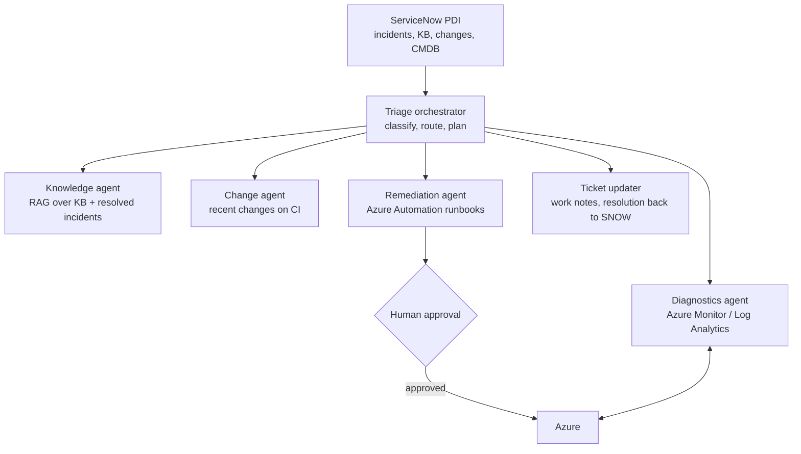
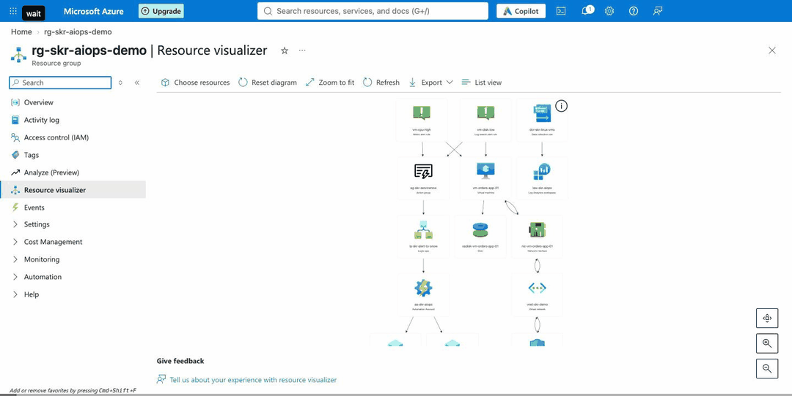

# agentic-aiops-servicenow-azure

Multi-agent AI that triages, diagnoses and remediates Azure incidents in ServiceNow, with
human-in-the-loop approval. The repo includes a synthetic enterprise dataset and an evaluation set.

> **Disclaimer:** *ShopKart Retails (SKR)* is a fictional company. All people, emails, IPs, systems and
> tickets in this repo are synthetic. No client or employer data is used.

## Why this project

IT managed-services work is shifting from people working tickets to AI-run operations that are
accountable for outcomes. This project shows that shift end to end on a realistic Azure + ServiceNow estate:

- **Faster triage.** Each incident is routed to the right resolver group with the right priority.
- **Root cause with evidence.** The system uses similar past incidents, KB articles, recent changes and Azure telemetry.
- **Safe automation.** Runbooks run only when the KB marks them safe, and only after a person approves.
- **Measured results.** Everything is scored against a labelled evaluation set, not demo anecdotes.

## Architecture



## Live demo

Real faults on an Azure VM went from **Azure Monitor alert → ServiceNow incident → multi-agent triage on real
telemetry → human approval → Azure Automation runbook → incident auto-resolved**, with one click from a person.
Timelines, screenshots, guardrails and what went wrong: **[docs/live-demo.md](docs/live-demo.md)**.



**Video (2:25):** one full run recorded live, from fault to auto-resolved incident, with captions:
[docs/live-demo/live-demo-run.mp4](docs/live-demo/live-demo-run.mp4).

https://github.com/user-attachments/assets/bbbaeafc-4e35-4b1c-820e-4a331d87126e

## Repo layout

```
synthetic-data/      ShopKart Retails ITSM dataset generator + ServiceNow loader (start here)
agents/              triage orchestrator, specialist agents, ServiceNow/Azure connectors (offline mocks included)
evaluation/          scoring against synthetic-data/data/ground_truth.json, plus committed results
tests/               pytest suite, including answer-key isolation and remediation safety
infra/               Bicep for the live Azure demo, runbooks, Logic App, fault scripts
docs/                live demo write-up and screenshots
```

## Roadmap

- [x] Synthetic enterprise data: 300+ incidents, CMDB, KB, changes, problems, and a 24-incident eval set
- [x] Load data into a ServiceNow PDI
- [x] Triage orchestrator (routing + priority), heuristic and Claude reasoners
- [x] Knowledge agent (BM25 over KB and resolved incidents; swap for vector search later)
- [x] Change-correlation agent
- [x] Diagnostics agent (KQL per resource type; synthetic workspace offline, Log Analytics connector for live)
- [x] Remediation agent with approval gate (Azure Automation connector, KB-safe runbooks only)
- [x] Evaluation scoring: routing, KB, runbook, root-cause match, change/problem linking, unsafe-action rate
- [x] Run against the live PDI (matches the offline baseline on all 24 eval incidents)
- [x] Live Azure loop: alert -> incident -> triage on Log Analytics -> approved runbook -> auto-resolve ([docs/live-demo.md](docs/live-demo.md))
- [ ] Claude reasoner vs heuristic comparison on the eval set
- [ ] MTTR saved (needs live timings)
- [x] Demo video ([docs/live-demo/live-demo-run.mp4](docs/live-demo/live-demo-run.mp4))

## Quick start

```bash
cd synthetic-data
pip install requests
python3 generate_data.py
export SN_INSTANCE=devXXXXXX SN_USER=admin SN_PASSWORD='...'
python3 load_to_snow.py --dry-run && python3 load_to_snow.py
```

See [synthetic-data/README.md](synthetic-data/README.md) for details.

### Triage and score (offline, no credentials)

```bash
python -m agents --out runs/latest          # triage the 24 open incidents
python -m evaluation.score runs/latest/predictions.json
pip install pytest && python -m pytest -q
```

Baseline results: [evaluation/README.md](evaluation/README.md). How the agents work, the live
ServiceNow / Azure / Claude options and the guardrails: [agents/README.md](agents/README.md).
