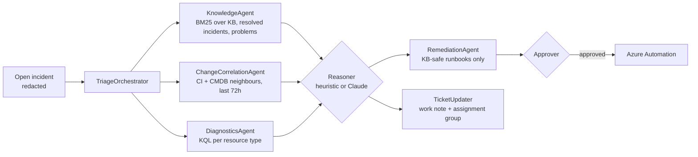

# Triage orchestrator and agents



| Module | Role |
|---|---|
| `orchestrator.py` | Runs the agents for each incident, then reasoner → remediation → ticket update |
| `knowledge.py` | Retrieves KB articles, similar resolved incidents (with their root cause and runbook from work notes) and known-error problems |
| `change.py` | Finds changes on the CI and its direct CMDB dependencies before the incident, scored by recency, same-CI and symptom keywords |
| `diagnostics.py` | Picks KQL for the resource family (VM, SQL, App Service, Key Vault, storage, AKS, ADF, ...) and extracts signals: processes, error codes, HTTP codes, KB numbers, versions |
| `reasoner.py` | `HeuristicReasoner` (offline baseline) or `ClaudeReasoner` (structured output, enums restricted to real groups / KB titles / candidate ids, falls back to the heuristic on API errors) |
| `remediation.py` | Safety policy + approval gate (`DenyAll` default for live, `InteractiveApprover`, `SimulatedApprover` for eval only) |
| `ticket.py` | Renders the work note and writes it plus the assignment group back |
| `connectors/` | `ITSMClient`, `LogAnalyticsClient`, `AutomationClient` interfaces with offline (`local.py`) and live (`servicenow.py`, `azure.py`) implementations |

## Run it

```bash
# offline, no credentials: local CSVs + synthetic Log Analytics + mock Automation
python -m agents --out runs/latest -v
python -m evaluation.score runs/latest/predictions.json

# Claude as the reasoner (default model claude-opus-5-5; needs ANTHROPIC_API_KEY or `ant auth login`)
pip install anthropic
python -m agents --reasoner claude --out runs/claude
python -m evaluation.score runs/claude/predictions.json

# live PDI, nothing else live yet: read incidents from ServiceNow, dry-run writes, no runbooks run
python -m agents --source servicenow --telemetry synthetic --automation mock --approver deny --out runs/pdi
python -m evaluation.score runs/pdi/predictions.json --truth synthetic-data/data/ground_truth.loaded.json

# live PDI (read + dry-run writes), real Log Analytics, runbooks only after a person approves at the console
export SN_INSTANCE=devXXXXXX SN_USER=admin SN_PASSWORD='...'
export LOG_ANALYTICS_WORKSPACE_ID=... AZURE_SUBSCRIPTION_ID=... AUTOMATION_RESOURCE_GROUP=... AUTOMATION_ACCOUNT=...
python -m agents --source servicenow --telemetry azure --automation azure --approver interactive --out runs/pdi
python -m evaluation.score runs/pdi/predictions.json --truth synthetic-data/data/ground_truth.loaded.json
# add --write to actually PATCH the incidents
```

Each run writes `predictions.json` (decision, remediation and all evidence per incident), `run.json`,
`automation_jobs.json`, and `ticket_updates.jsonl` (offline outbox) or `ticket_updates.json` (ServiceNow).

## Guardrails

- **No answer key.** Agents only see ITSM data through an `ITSMClient`. Open incidents are redacted
  (`assignment_group`, `caused_by`, `problem_id`, work/close notes) because the generator fills
  `caused_by` and `problem_id` on the eval incidents. `LocalITSM` reads only `data/csv/` and refuses any
  `ground_truth*` path. `tests/test_answer_key_isolation.py` runs the whole pipeline with `open()` patched
  to fail on the answer key.
- **Runbooks come from the KB only.** The reasoner picks a KB article from a closed list; the runbook and
  its safe flag are read from that article. A model cannot invent or upgrade a runbook.
- **Unsafe runbooks are never automated.** "Do NOT auto-run" runbooks, noise tickets, incidents without a
  CI, and low-confidence triage become manual recommendations.
- **Nothing runs without approval.** `--approver simulate` (approve everything) is refused unless
  automation is the mock, and exists so the eval measures the worst case.
- **ServiceNow writes are dry-run by default** (`--write` to send). Suspected change and problem links go
  into the work note for an engineer to confirm, not into `caused_by` / `problem_id`.
