# Live demo: from Azure alert to auto-resolved ServiceNow incident

On 2026-11-16 three real faults on an Azure VM went through the whole loop with no manual step except one
approval: Azure Monitor alert → ServiceNow incident → multi-agent triage on real telemetry → human approval →
Azure Automation runbook → alert clears → incident resolved with an *Auto-remediated (AIOps)* close code.

Everything runs on a free-trial Azure subscription and a ServiceNow Personal Developer Instance (PDI). The company,
people and tickets are synthetic (ShopKart Retails, tag `SYNTH-SKR`). Infrastructure: [`infra/`](../infra/README.md).

A 40-second tour of the evidence (recorded in the Azure portal and the PDI after the runs): the deployed resources,
the CPU fault, both alerts resolved, the disk-cleanup runbook's output, and INC0010599 going *New → In Progress →
Resolved (Auto-remediated)*.

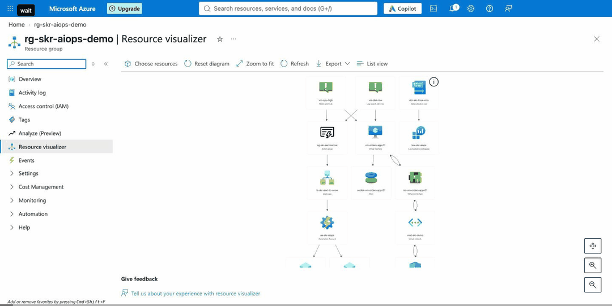

### Video: one run, start to finish (2:25)

The third run (disk full, **INC0010600**) was screen-recorded. Waits are cut or sped up, captions explain each step, and
browser bars are cropped out. Watch [live-demo/live-demo-run.mp4](live-demo/live-demo-run.mp4).

[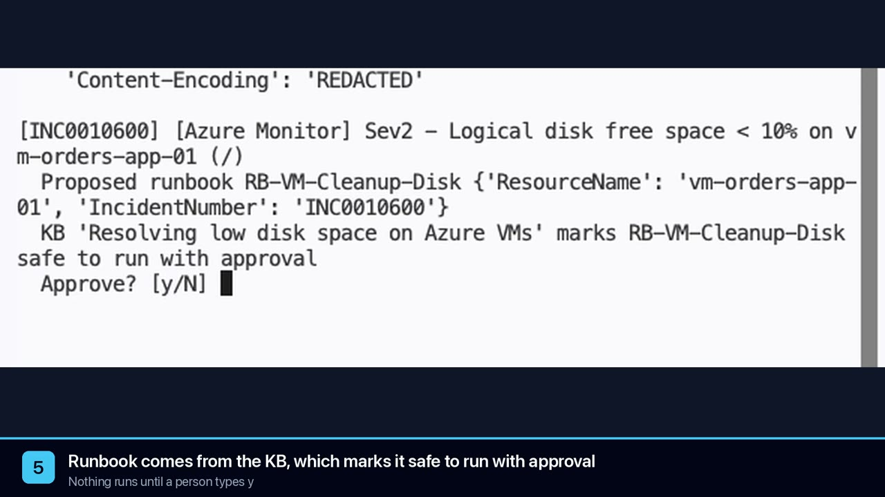](live-demo/live-demo-run.mp4)

| Time (UTC) | What happened |
|---|---|
| 10:59:54 | `inject.sh disk`: `/` from 95 % to 5 % free |
| 11:19:25 | `vm-disk-low` fired; the Logic App created **INC0010600** (New, default group *SKR App Support*) |
| 11:23 | Triage on live data (39 Log Analytics rows): **SKR Azure Infra Ops**, P3, KB *Resolving low disk space on Azure VMs*, confidence 0.94; **RB-VM-Cleanup-Disk** approved at the prompt; incident In Progress |
| 11:23:45 to 11:24:31 | Job `59b803bb` completed: 55 GB log truncated, `/` back to 5 % used |
| 11:45:24 | Alert cleared; the Logic App resolved INC0010600 with close code *Auto-remediated (AIOps)* |

## The loop

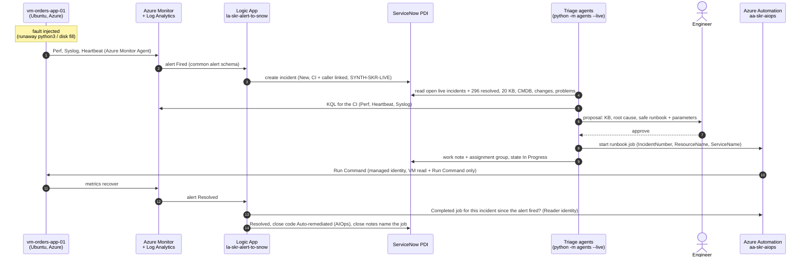

## Run 1: high CPU (INC0010598)

| Time (UTC) | What happened |
|---|---|
| 06:26 | `infra/faults/inject.sh cpu`: a runaway `python3` loop on both vCPUs; the "app" logs a warning to Syslog |
| 06:29 | Percentage CPU 95–99 % |
| 06:42 | `vm-cpu-high` fired (15-min average > 90 %); the Logic App created **INC0010598** |
| 06:44 | Triage (heuristic reasoner, real data): **SKR Azure Infra Ops**, KB *Troubleshooting high CPU on Azure VMs*, confidence 0.95; 68 rows from Log Analytics; `python3` taken from the real Syslog line; proposed **RB-VM-Restart-Service** with `ServiceName=python3`; approved at the prompt |
| 06:46 | First job reported *Completed* but its bash had failed (see [what went wrong](#what-went-wrong-and-what-changed)) |
| 06:49 | Fixed runbook: stopped both runaway processes, left the Azure guest agent's own `python3` (0.1 % CPU) alone |
| 06:53 | CPU 0.6 % |
| 06:55 | Alert resolved |

Runbook output (job `1adf28a3`):
```
before: load 2.17 2.12 1.74
stopping pid 3098: 99.3 python3 -c while True: pass
stopping pid 3099: 99.3 python3 -c while True: pass
after: load 1.69 2.01 1.71
```

## Run 2: disk full, fully automatic close (INC0010599)

| Time (UTC) | What happened |
|---|---|
| 07:53 | `inject.sh disk`: a 55 GB `orders-debug.log` ("log rotation disabled"), `/` 96 % used |
| ~08:10 | `vm-disk-low` fired (10-min average free space < 10 %); **INC0010599** created |
| ~08:16 | Triage: **SKR Azure Infra Ops**, KB *Resolving low disk space on Azure VMs*, confidence 0.94, root cause *Log rotation job disabled after last patching*; proposed **RB-VM-Cleanup-Disk**, approved; incident set to **In Progress** |
| 08:18 | Job `8d39a8d8` completed: log truncated in place (last 1 MB kept), `/` back to 5 % used |
| 08:35 | Alert cleared; the Logic App found the Completed job for INC0010599 and **resolved** the incident |

Close notes written by the Logic App:
> Auto-remediated by AIOps. Approved runbook: RB-VM-Cleanup-Disk job 8d39a8d8-… completed 2026-11-16T08:17:50Z.
> Azure Monitor alert vm-disk-low cleared at 2026-11-16T08:35:23Z. Reopen if the problem returns.

## Screenshots

Captured from the Azure portal and the ServiceNow PDI after the runs. Azure shows UTC or IST (UTC+5:30) as labelled;
the PDI shows its own time zone (US Pacific, UTC-8), so 00:09 there is 08:09 UTC.

**1. What is deployed.** The resource group in Azure's resource visualizer: alert rules → action group → Logic App →
Automation account → the two safe runbooks, and the VM with its disk, network and the workspace it reports to.

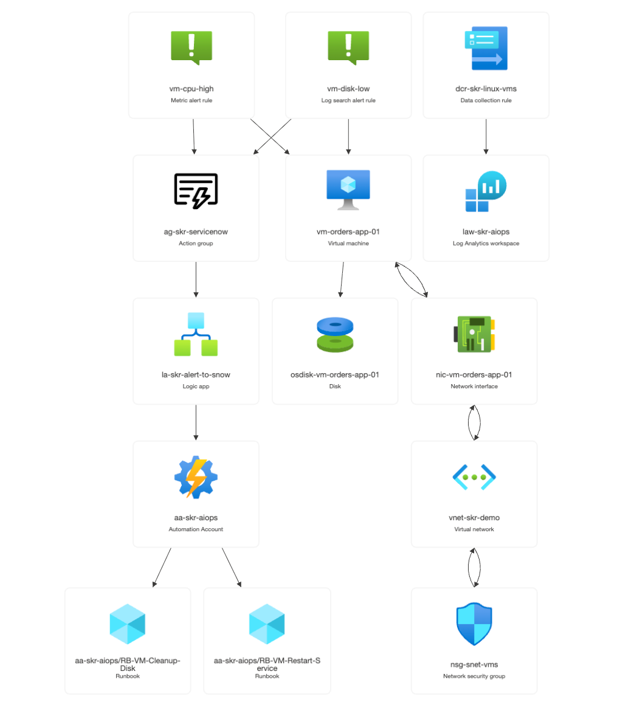

**2. Alert rules**, named like the alerts in the KB history so retrieval matches them.

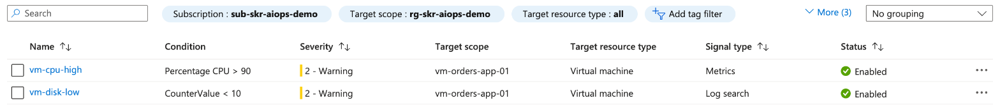

**3. The faults, as Azure saw them.** CPU from the platform metric (runaway `python3` 06:27–06:50 UTC, then flat
after the runbook), and free space on `/` from Log Analytics (95 % → 5 % at 07:54, back at 08:18 after the cleanup).

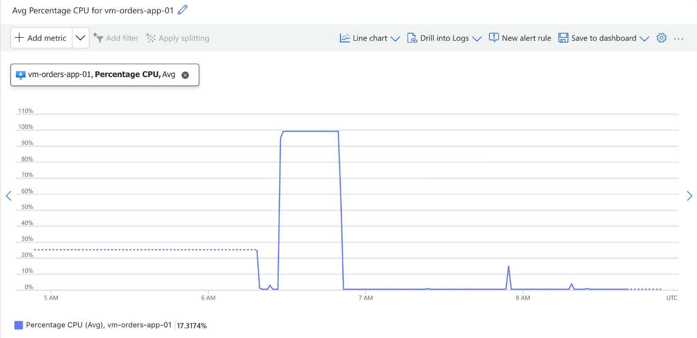

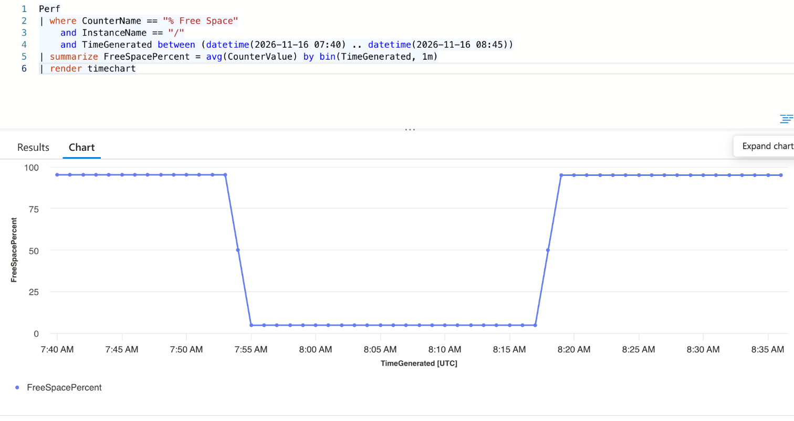

**4. Both alerts fired and resolved** (times in IST).

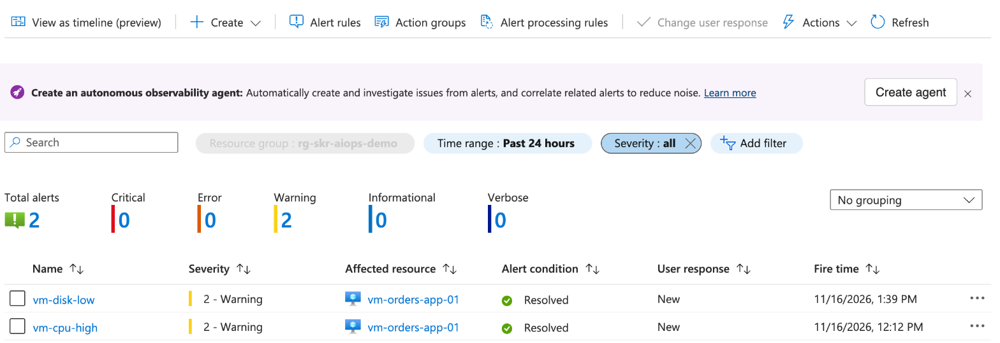

**5. Runbook jobs** in Azure Automation (IST): the disk cleanup (13:46), the fixed CPU job (12:18), the first CPU job
that "Completed" without fixing anything (12:14, see below), and yesterday's tests, including the guard that refused
`ServiceName=sshd` (Failed, as intended).

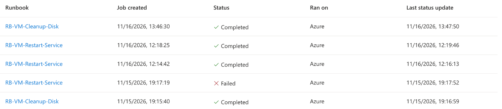

**6. What the cleanup runbook did on the VM.** The Id shown is Automation's internal job id; the ServiceNow notes quote
the job *name* the agents assigned when starting it (`8d39a8d8…`).

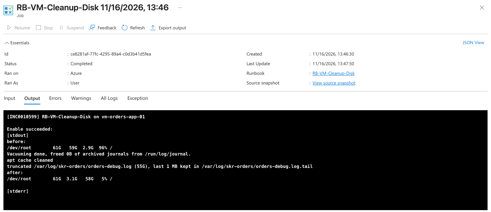

**7. How the incident got resolved.** The Logic App run for the cleared disk alert: find the open incident, list
*Completed* jobs since the alert fired, match the incident number, then *Resolve incident*.

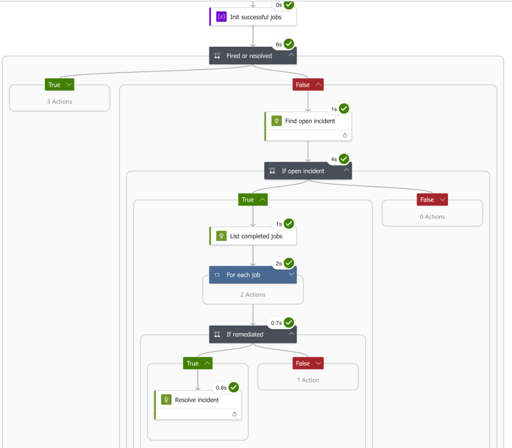

**8. The incidents in ServiceNow.** The two live incidents resolved and routed to *SKR Azure Infra Ops* by the triage
(INC0010597 was a manual test of the Logic App, closed by hand).

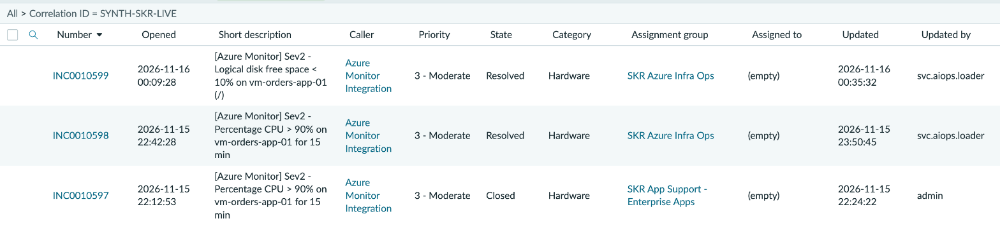

**9. INC0010599**, as the Logic App created it from the alert,

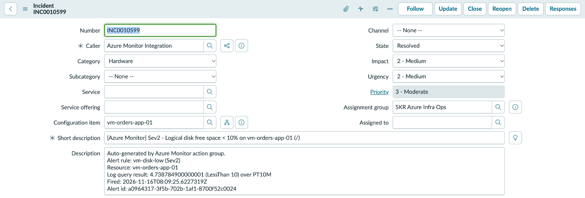

its resolution, filterable by the *Auto-remediated (AIOps)* resolution code,

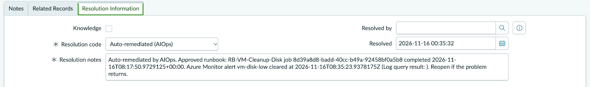

and the whole lifecycle in its activity stream (read bottom-up): created *New* from the alert → triage work note and
*In Progress* → *Resolved* with the close code once the alert cleared after the approved runbook.

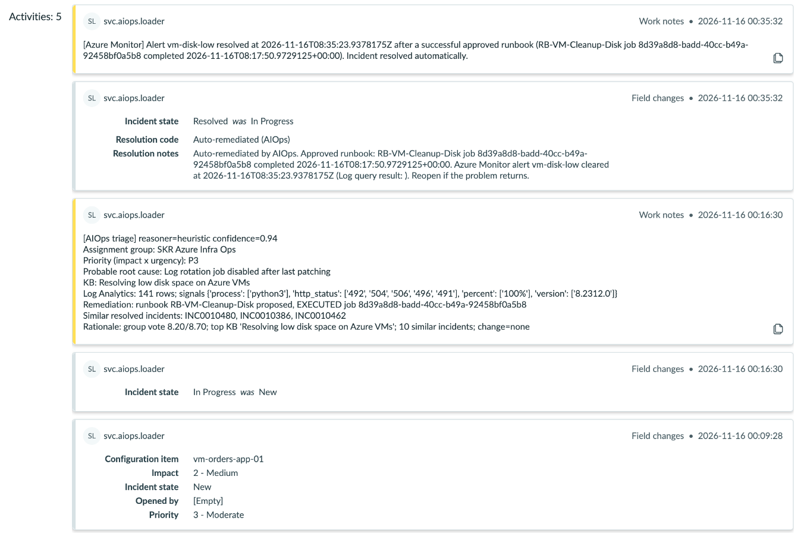

## Guardrails that held

- **Only KB-approved runbooks.** The runbook comes from the matched KB article; only articles that say "safe to run
  automatically" can be automated, and only two such runbooks exist in Azure Automation. "Do NOT auto-run" runbooks
  are never imported.
- **A person approves every run** (`--approver interactive`). Simulated approvals can never be written to a real ticket
  (`--write` refuses `--approver simulate`).
- **Runbook must fit the target.** A runbook is only automated on a CI, or CI class, it has run on before in the
  incident history. In the offline evaluation this blocks the one unsafe case (an IIS recycle proposed for an App Service).
- **Least privilege.** The Automation identity has a custom role: VM read + Run Command on one resource group. It
  cannot start, stop, resize or delete VMs. The Logic App can read job history but cannot start jobs. Local auth on
  the Automation account is off.
- **Runbook guards.** Only VMs tagged `dataset=SYNTH-SKR`, Linux only; the restart runbook refuses system processes
  (tested: `ServiceName=sshd` → job Failed, "protected system process") and only stops processes above 50 % CPU; the
  cleanup runbook never deletes files.
- **Resolve only on evidence.** A cleared alert alone does not close a ticket: the Logic App resolves only when a
  *Completed* runbook job for that incident started after the alert fired. Otherwise it adds "needs review: the symptom
  may have cleared on its own". Incidents already worked by a person are left alone.
- **Eval set untouched.** Live incidents use `correlation_id=SYNTH-SKR-LIVE`; the 24 evaluation incidents keep
  `SYNTH-SKR`, stay *New*, and are still scored offline (24/24 routing, 0 unsafe executions).

## What went wrong, and what changed

- **A runbook reported success without fixing anything.** The first CPU job built its bash script inside an expanding
  PowerShell string; one escaped quote broke the script, and because Run Command returns no exit code the job still
  ended *Completed*. Fix: the bash now lives in a non-expanding string, and **both runbooks fail the job when the VM
  script writes anything to stderr**. This is the most important lesson of the run: a remediation must be judged by
  its effect, not its exit status.
- **The free trial has limits.** B1s/B2s VMs are not offered (B2ats_v2 is), and Automation accounts can only be created
  in six regions, so the account runs in Southeast Asia while the VM is in Central India (Run Command works across
  regions).
- **Linux telemetry differs.** The Diagnostics agent's KQL assumed Windows (`Event` table, `Available MBytes`); it now
  uses `union isfuzzy=true`, the Linux counter name, and Syslog for process names.

### Fixed after the runs

The runs surfaced four smaller problems. Each fix was measured on the 24-incident evaluation and, where it touched
telemetry, replayed against the real workspace:

| Seen in the live run | Fix | Result |
|---|---|---|
| CPU root cause came from the history vote ("Batch job overlapping with peak traffic": 7 of 10 similar incidents) although the VM's own Syslog named `python3` | A cause whose specifics (process, error code, version) the incident's own evidence confirms gets a fixed bonus over causes that are merely common in the history | Live CPU replay: "Runaway python3 process after long uptime". Eval root cause 21/24 → **22/24** (mean F1 0.858 → 0.900), nothing else changed |
| The `http_status` signal picked numbers such as 526 out of Perf rows (526.9 MB free memory) | Signals come only from log messages (Syslog, Event, alert text) and the description | No fake status codes in either live replay |
| A 24 h Diagnostics lookback carried the CPU fault's Syslog line into the disk incident 1h43m later | Lookback 24 h → 2 h | Live disk replay: no stray `python3`; the CPU replay still finds it (logged 16 min before the alert). Eval identical from 1 h to 24 h |
| A cleared *log* alert carries no measured value, so close notes read "(Log query result: )" | The Logic App adds "(metric: value)" only when Azure supplies a value | Applies from the next alert |

## Run it yourself

```bash
# once: deploy (infra/README.md), add the close code, then
infra/faults/inject.sh cpu            # or disk; the alert fires after ~15 min (CPU) / ~15 min (disk)
# when the incident appears in ServiceNow (zsh with SN_INSTANCE / SN_USER / SN_PASSWORD set):
export LOG_ANALYTICS_WORKSPACE_ID=<workspace id> AZURE_SUBSCRIPTION_ID=$(az account show --query id -o tsv) \
       AUTOMATION_RESOURCE_GROUP=rg-skr-aiops-demo AUTOMATION_ACCOUNT=aa-skr-aiops
python -m agents --source servicenow --live --telemetry azure --automation azure \
       --approver interactive --write --out runs/live -v      # approve at the prompt
```

Cost: the VM is a free-tier size with nightly auto-shutdown; the workspace has a 0.15 GB/day cap; the log alert is
about $1.50/month; everything else is within free allowances.
